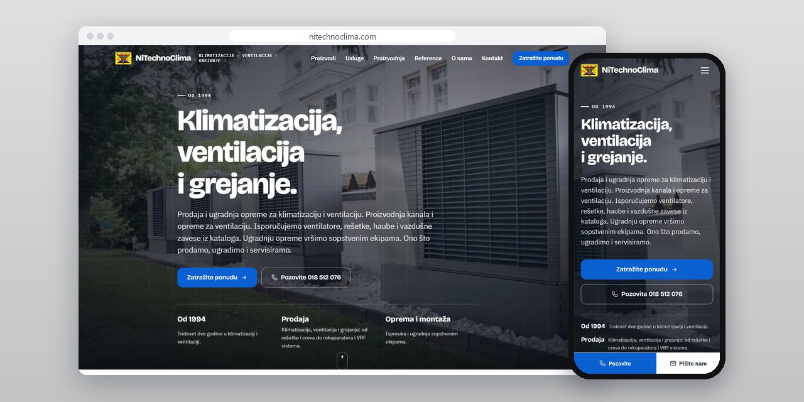
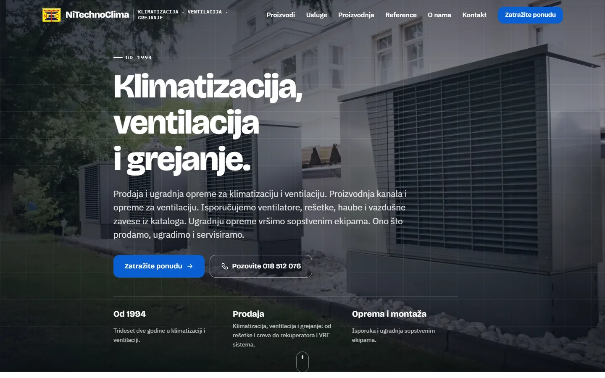
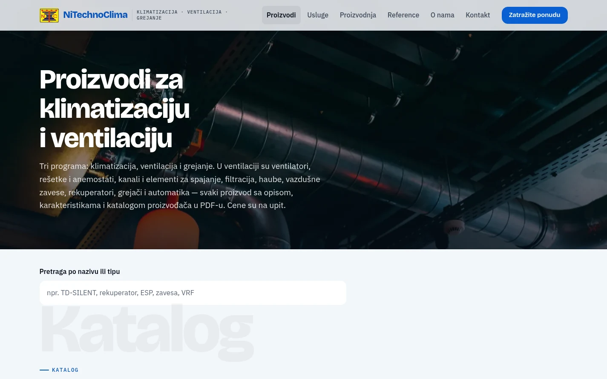
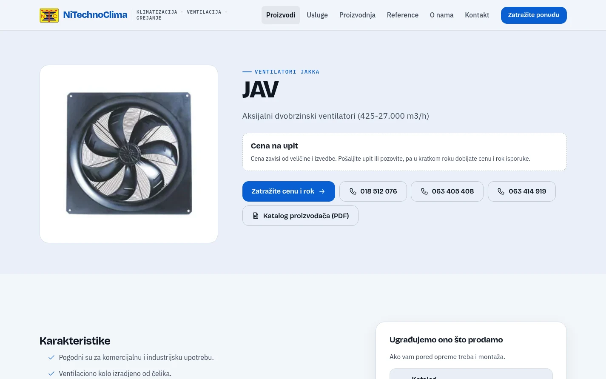

# NiTechno Clima

Website for an HVAC company from Niš: 325 pages, a catalogue of 252 products with manufacturers' PDF catalogues, and editing directly on the page.

**[nitechnoclima.com](https://nitechnoclima.com/)** · [Case study (in Serbian)](https://svilenkovic.rs/radovi/nitechno-clima) · [Srpski](README.sr.md)

> [!NOTE]
> Client project. The source code belongs to the client and stays in a private repository. This page describes what I built and how.

<table>
  <tr><td><b>Client</b></td><td>NiTechno Clima</td></tr>
  <tr><td><b>Industry</b></td><td>Air conditioning, ventilation and heating</td></tr>
  <tr><td><b>Location</b></td><td>Niš, Serbia</td></tr>
  <tr><td><b>Type</b></td><td>Multi-page website with a catalogue</td></tr>
  <tr><td><b>My role</b></td><td>Redesign, development and migration</td></tr>
  <tr><td><b>Stack</b></td><td>PHP, Apache, JSON-LD</td></tr>
</table>

## About the project

NiTechno Clima from Niš makes ducts and ventilation equipment, supplies equipment from its catalogue and installs it with its own crews. Their old site ran on WordPress. The new one had to show every product on its own page and let the company change the content itself.

I wrote the new site from scratch in PHP, without a database, so it runs on the hosting the company already has. After logging in, the editor changes text with a click and photos with a button on the image, right on the page visitors see. Page addresses and the titles and descriptions for Google stay on the system side, and every save is checked and backed up before it changes a file.

## What I built

- A catalogue in three ranges, air conditioning, ventilation and heating, with 252 products, each on its own page
- A manufacturer's PDF catalogue on 100 product pages, prices on request and a search by name or type
- Editing on the page itself: text with a click, photos with a button, cards, steps and questions with a toolbar
- New pages and PDF catalogues added through a bar at the bottom of the screen, with a backup and a change log
- Old WordPress addresses for products, categories and PDF files mapped to the new pages with permanent redirects
- Security headers and a content security policy through Apache, and structured data for an HVAC business

## Results

| | Performance | Accessibility | Best practices | SEO |
| :-- | :-: | :-: | :-: | :-: |
| Mobile | 100 | 100 | 100 | 100 |
| Desktop | 100 | 100 | 100 | 100 |

PageSpeed Insights, lab test of the live site, November 2026. Security headers: 6 of 6. Structured data: `FAQPage`, `HVACBusiness`.

## Screenshots

<table>
  <tr>
    <td width="68%" valign="top"></td>
    <td width="32%" valign="top"></td>
  </tr>
</table>

The catalogue: three ranges and a search by name or type

A product page with the price on request and the manufacturer's PDF catalogue

---

Built by [D. Svilenković](https://svilenkovic.com).
