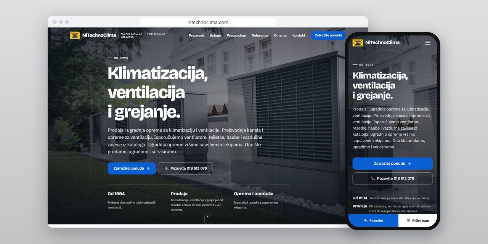
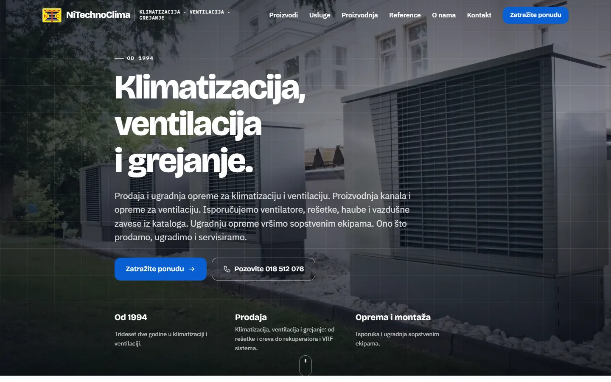
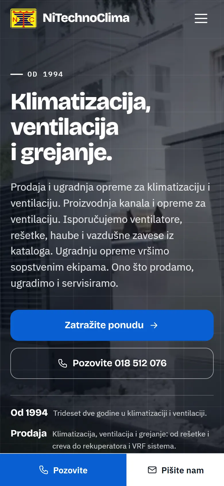
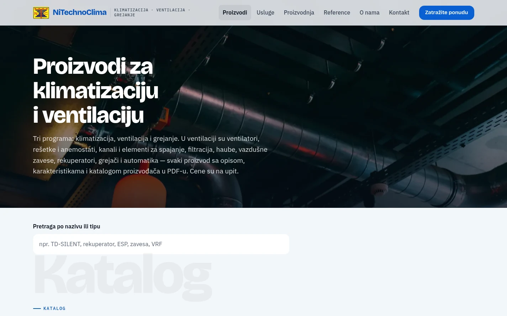
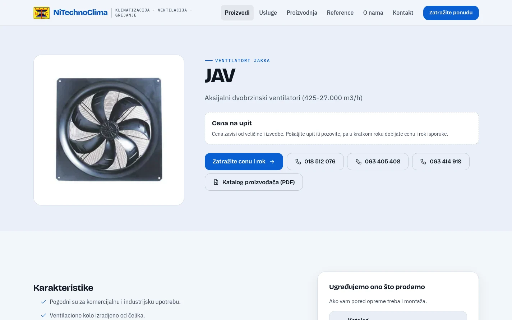

# NiTechno Clima

Sajt za firmu iz Niša koja radi klimatizaciju, ventilaciju i grejanje: 325 strana, katalog od 252 proizvoda i uređivanje na samoj strani.

**[nitechnoclima.com](https://nitechnoclima.com/)** · [Studija slučaja](https://svilenkovic.rs/radovi/nitechno-clima) · [English](README.md)

> [!NOTE]
> Klijentski projekat. Izvorni kod pripada klijentu i čuva se u privatnom repozitorijumu. Ova stranica opisuje šta sam uradio i kako.

<table>
  <tr><td><b>Klijent</b></td><td>NiTechno Clima</td></tr>
  <tr><td><b>Delatnost</b></td><td>Klimatizacija, ventilacija i grejanje</td></tr>
  <tr><td><b>Lokacija</b></td><td>Niš</td></tr>
  <tr><td><b>Vrsta</b></td><td>Sajt sa više strana i katalogom</td></tr>
  <tr><td><b>Moj deo posla</b></td><td>Redizajn, izrada i selidba</td></tr>
  <tr><td><b>Tehnologije</b></td><td>PHP, Apache, JSON-LD</td></tr>
</table>

## O projektu

NiTechno Clima iz Niša proizvodi kanale i opremu za ventilaciju, isporučuje opremu iz kataloga i ugrađuje je sopstvenim ekipama. Stari sajt bio je na WordPressu. Nov je trebalo da svakom proizvodu da svoju stranu i da firma sadržaj menja sama.

Nov sajt sam napisao od nule u PHP-u, bez baze podataka, pa radi na hostingu koji firma već ima. Posle prijave urednik menja tekst klikom, a fotografiju dugmetom na slici, na istoj strani koju vidi posetilac. Adrese strana i naslovi i opisi za Google ostaju na strani sistema, a svaki upis se proveri i sačuva u rezervi pre nego što promeni fajl.

## Šta sam uradio

- Katalog u tri programa, klimatizacija, ventilacija i grejanje, sa 252 proizvoda, svaki na svojoj strani
- Katalog proizvođača u PDF-u na 100 strana proizvoda, cene na upit i pretraga po nazivu ili tipu
- Uređivanje na samoj strani: tekst klikom, fotografije dugmetom, kartice, koraci i pitanja alatkom iznad njih
- Nove strane i PDF katalozi kroz traku na dnu ekrana, uz rezervu i dnevnik izmena
- Stare WordPress adrese proizvoda, kategorija i PDF fajlova povezane sa novim stranama trajnim preusmerenjem
- Bezbednosna zaglavlja i pravila sadržaja kroz Apache, i strukturisani podaci za firmu iz oblasti klimatizacije

## Merenja

| | Performanse | Pristupačnost | Dobre prakse | SEO |
| :-- | :-: | :-: | :-: | :-: |
| Telefon | 100 | 100 | 100 | 100 |
| Desktop | 100 | 100 | 100 | 100 |

PageSpeed Insights, laboratorijsko merenje živog sajta, novembar 2026. Sigurnosna zaglavlja: 6 od 6. Strukturisani podaci: `FAQPage`, `HVACBusiness`.

## Snimci ekrana

<table>
  <tr>
    <td width="68%" valign="top"></td>
    <td width="32%" valign="top"></td>
  </tr>
</table>

Katalog: tri programa i pretraga po nazivu ili tipu

Strana proizvoda sa cenom na upit i katalogom proizvođača u PDF-u

---

Izrada: [D. Svilenković](https://svilenkovic.rs).
